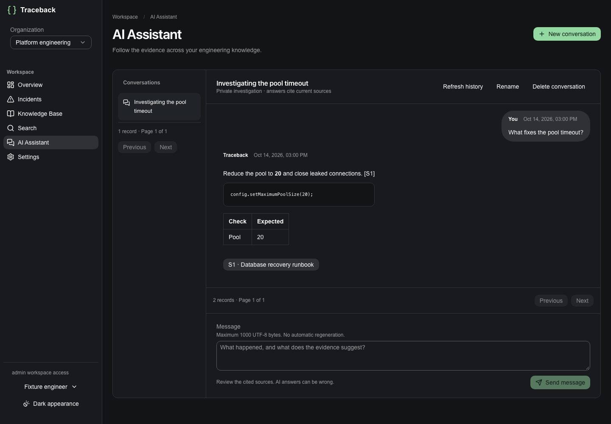
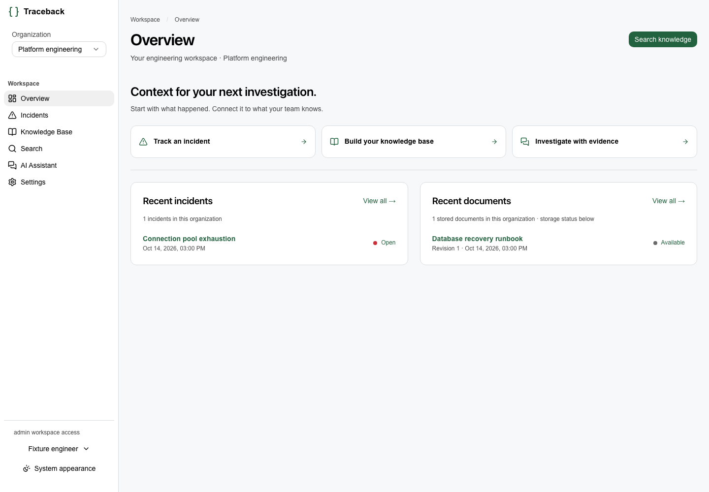
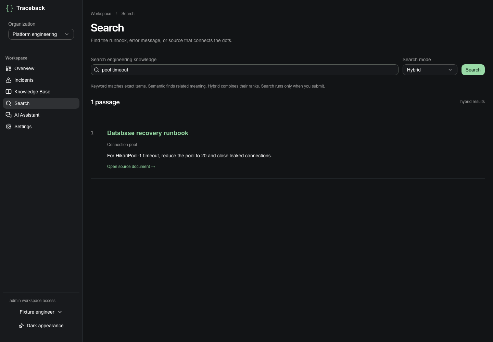
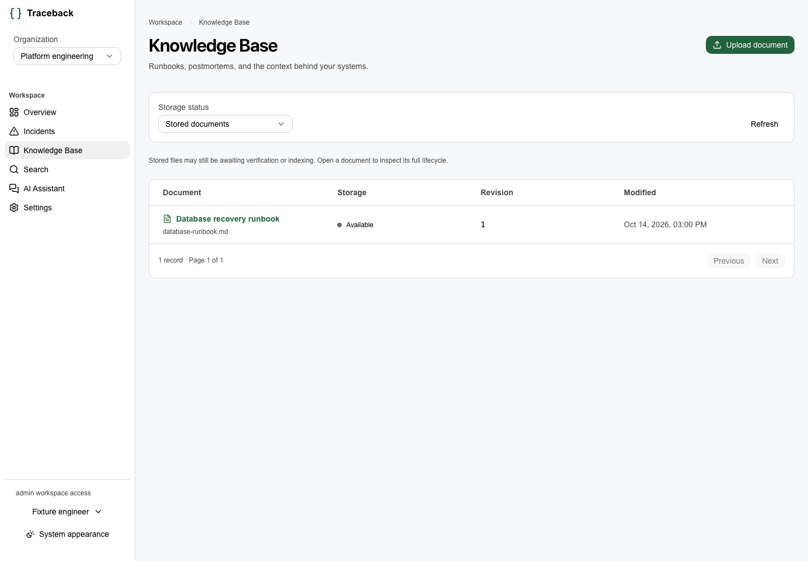
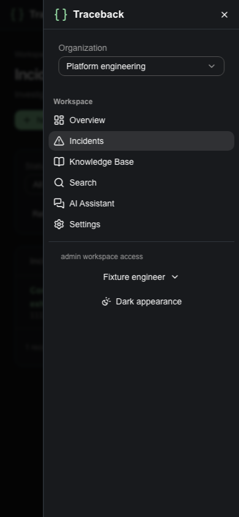
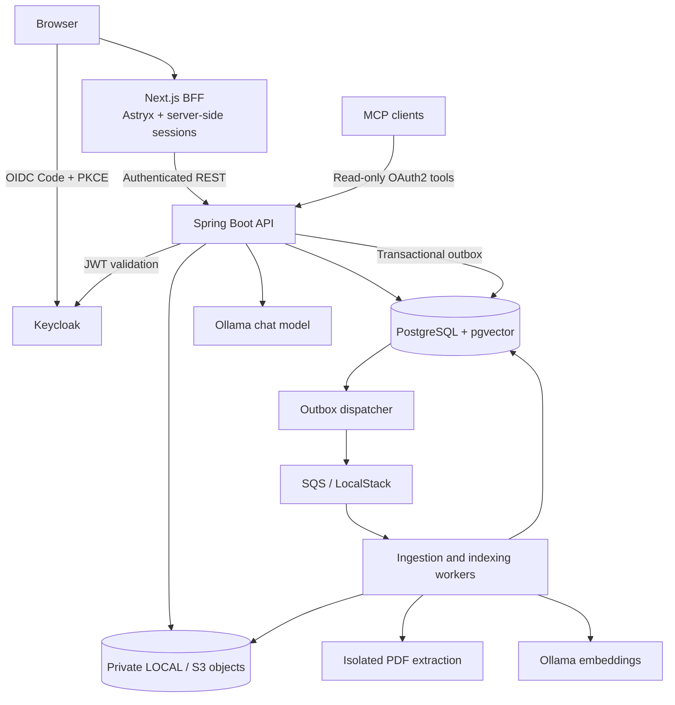

<div align="center">

# Traceback

### From incidents to answers, with the evidence to back them up.

**An engineering incident and knowledge platform that brings runbooks, postmortems, semantic search, and grounded AI assistance into one secure workspace.**

[](https://openjdk.org/)
[](https://spring.io/projects/spring-boot)
[](https://nextjs.org/)
[](https://www.postgresql.org/)
[](https://modelcontextprotocol.io/)
[](#project-status)

[Features](#features) · [Architecture](#architecture) · [Run locally](#run-locally) · [Testing](#testing) · [Technical decisions](docs/DECISIONS/README.md)



<sub>Real application UI with synthetic demonstration data.</sub>

</div>

## Why Traceback?

Engineering teams rarely lack information. They lack a fast way to connect an incident to the **right runbook, prior failure, or remediation step**.

Traceback combines incident management with a versioned knowledge base and a retrieval-augmented AI assistant. It helps engineers investigate failures using their team's own documentation—and inspect the evidence behind an answer rather than blindly trusting generated text.

## Features

| | Capability | What it does |
|:--:|---|---|
| 🚨 | **Incident tracking** | Create and investigate incidents, filter by status, and use optimistic locking to prevent accidental overwrites. |
| 📚 | **Versioned knowledge base** | Upload PDF, Markdown, or TXT files; retain immutable revisions, checksums, and controlled document lifecycles. |
| 🔎 | **Hybrid search** | Combine PostgreSQL full-text search with pgvector semantic similarity using Reciprocal Rank Fusion (RRF). |
| ✨ | **Grounded AI answers** | Ask questions over indexed documents, receive source-linked answers, and abstain when evidence is insufficient. |
| 💬 | **Persistent conversations** | Continue private, multi-turn investigations with durable messages, idempotent submissions, and source revalidation. |
| 🔌 | **Read-only MCP** | Let compatible AI clients search knowledge and inspect authorized incidents through six constrained tools. |
| 🛡️ | **Multi-tenant access control** | Isolate organizations using Keycloak/OIDC, database-backed membership, and `ADMIN` / `ENGINEER` / `VIEWER` roles. |
| ⚙️ | **Durable processing** | Verify, extract, chunk, embed, and index documents with PostgreSQL outbox events, SQS workers, retries, and recovery. |

### A look inside

<p align="center">
  
  
</p>
<p align="center">
  
  
</p>

## Architecture

Traceback is a **modular Spring Boot monolith** with a separate Next.js frontend and independently executable background workers. The application remains useful without LLM inference: incidents, documents, and keyword search are first-class functionality.



### Document-to-answer pipeline

```text
Upload → private immutable revision → checksum verification
       → isolated extraction → structure-aware chunks
       → local embeddings + PostgreSQL full-text index
       → atomic index publication
       → tenant-scoped hybrid retrieval
       → grounded chat response + validated citations
```

Index generations are published atomically, so partially indexed content does not appear in search. Document deletion, revision changes, and membership revocation are rechecked before serving evidence or previously generated citations.

### Technology

| Layer | Stack |
|---|---|
| Frontend | Next.js 16, React 19, TypeScript, Meta **Astryx** (Neutral theme), StyleX, TanStack Query |
| Backend | Java 21, Spring Boot 4.1.1, Spring Security, Spring AI, JPA/JDBC, Maven |
| Identity | Keycloak, OpenID Connect, Authorization Code + PKCE, OAuth2 resource audiences |
| Database | PostgreSQL 17, Flyway, pgvector, PostgreSQL full-text search |
| Storage & messaging | Filesystem/S3 adapters, AWS SDK for Java, SQS, transactional outbox; LocalStack for development |
| Local AI | `nomic-embed-text:v1.5` (embeddings), `qwen2.5:7b` (chat) via Ollama |
| Integrations | Stateless Streamable HTTP MCP server with six read-only tools |
| Testing & infrastructure | JUnit, Testcontainers, Vitest, Playwright, Docker, Terraform foundations, GitHub Actions |

## Run locally

The quickest way to explore the full UI is the **isolated M17 demo environment**. It creates synthetic credentials and uses disposable database storage; it **does not use your existing developer data**.

**Prerequisites:** Docker Engine/Desktop with Docker Compose, Python 3, and Node.js 22+ for the smoke script. The isolated PDF parser requires Docker/cgroup v2 support. Java 21 and npm are needed when working directly on the backend or frontend.

From the repository root:

```bash
# 1. Create an unused, private local fixture directory.
export M17_FIXTURE_DIRECTORY="/tmp/traceback-m17-demo-$(date +%s)"
python3 scripts/deployment/prepare_local.py --directory "$M17_FIXTURE_DIRECTORY"

# 2. Build and start the isolated application stack.
docker compose --env-file /dev/null -p traceback-m17 \
  -f compose.production-like.yaml up -d --build --wait

# 3. Optional: run the synthetic end-to-end smoke test.
node scripts/deployment/smoke.mjs
```

Open **http://127.0.0.1:18765** and sign in with the synthetic credentials saved in:

```text
$M17_FIXTURE_DIRECTORY/login.json
```

The demo starts the frontend, API, Keycloak, PostgreSQL, LocalStack, and worker. Services bind to local interfaces. **The demo database is ephemeral:** restarting its PostgreSQL container loses the synthetic data. Do not use this setup for valuable files or persistent work.

### Enable local AI (optional)

Semantic search and AI chat require the already-installed Ollama models. No model weights are downloaded automatically. If the existing model volumes are available and Docker has adequate memory, enable the appropriate services:

```bash
export M17_INDEXING_ENABLED=true
export M17_CHAT_ENABLED=true

docker compose --env-file /dev/null -p traceback-m17 \
  -f compose.production-like.yaml \
  -f compose.production-like.models.yaml --profile models \
  up -d --wait api worker ollama chat-ollama
```

The embedding service is capped at 2 GiB and the 7B chat model at 8 GiB in the local model configuration. Chat inference can take tens of seconds on CPU; indexing and chat remain opt-in.

### Stop the demo

```bash
docker compose --env-file /dev/null -p traceback-m17 \
  -f compose.production-like.yaml stop
```

If you enabled the optional Ollama services, stop them with the same command **including** `-f compose.production-like.models.yaml --profile models`. Avoid `down -v` if you want to preserve named model or developer volumes. For non-disposable development configuration and additional startup options, see [M16 frontend setup](docs/M16_FRONTEND.md) and [M17 deployment guide](docs/M17_DEPLOYMENT.md).

## Using Traceback

1. **Sign in** through Keycloak and create or select an organization.
2. **Record an incident** and track its investigation status.
3. **Upload a runbook** or postmortem in the Knowledge Base.
4. **Enable indexing**, then wait for the document's indexing state to reach `INDEXED`.
5. **Search** using keyword, semantic, or hybrid mode.
6. **Ask the AI assistant** an engineering question; open a citation to inspect the current authorized source.

For example: *“What should we check when PostgreSQL connections are exhausted, and which recovery steps are documented?”*

## Security by design

- **Tenant isolation:** incident, document, search, conversation, and MCP paths enforce live database membership and organization ownership.
- **Least privilege:** database-backed `ADMIN`, `ENGINEER`, and `VIEWER` roles; read-only MCP operations.
- **Server-managed sessions:** browser receives an opaque HttpOnly cookie; Keycloak access/refresh tokens remain server-side.
- **Private evidence:** object keys are opaque; downloads and citations are reauthorized; deleted or superseded sources become inaccessible.
- **Untrusted input handling:** bounded uploads, isolated PDF parsing, safe Markdown rendering, and evidence/citation validation.
- **Reliable writes:** document revisions are immutable; database outbox, worker leases, retry/DLQ handling, and optimistic concurrency limit partial failures.

Security testing does not constitute a production security certification. See [M15 security & evaluation](docs/M15_SECURITY_AND_EVALUATION.md) for detailed threat models and results.

## Testing

Most recent **local** M17 verification reported:

| Suite | Result |
|---|---:|
| Java backend (`clean test` / `verify`) | **244 tests passing** |
| Frontend unit/component tests | **37 passing** |
| Chromium browser E2E tests | **14 passing** |
| Container image scans | No HIGH/CRITICAL matches in tested images |

Run the core checks:

```bash
# Backend (Java 21, Docker/Testcontainers)
cd backend
./mvnw clean test
./mvnw verify

# Frontend (Node 22+)
cd ../frontend
npm ci
npm run typecheck
npm run lint
npm run test
npm run build
npm run test:e2e
```

Additional evaluation suites cover hybrid-retrieval quality, grounded-answer and citation behavior, authorization isolation, MCP protocol interoperability, and failure recovery. See [evaluations](evaluations/), [M15 report](docs/M15_SECURITY_AND_EVALUATION.md), and [M17 verification](docs/M17_VERIFICATION.json).

## Repository structure

```text
traceback/
├── frontend/                 # Next.js, Astryx UI, OIDC BFF and UI tests
├── backend/                  # Java API, workers, security, RAG and MCP
├── infra/terraform/          # AWS infrastructure foundations (not deployed)
├── scripts/                  # Local environment, smoke and operations scripts
├── evaluations/              # Retrieval and RAG quality benchmarks
├── docs/                     # Architecture, milestone guides and ADRs
├── compose.yaml              # Developer services
├── compose.production-like.yaml
└── compose.production-like.models.yaml
```

## Project status

**The end-to-end application is implemented and locally verified. It is not publicly deployed.** Terraform currently covers AWS foundations, but runtime compute/ingress, production identity/secrets, live cloud validation, and production PDF isolation still require approved implementation and testing.

Current scaling constraints are explicit: **one API writer** and **one frontend Node process** (sessions are in memory). The demo's storage is disposable. No public endpoint or hosted SaaS availability is claimed.

For deployment trade-offs, cost estimates, unresolved blockers, and recovery plans, read [M17 deployment readiness](docs/M17_DEPLOYMENT.md).

---

<div align="center">

**Built by [Alexandru Grecu](https://github.com/GrecuAlexandru)**

<sub>Traceback is an engineering project focused on reliable systems, secure multi-tenancy, and evidence-grounded AI.</sub>

</div>
