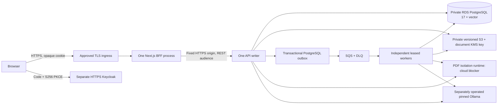

# M17 — Infrastructure, deployment and production readiness

Status: local implementation and verification complete; **M17 review pending, cloud
deployment blocked, no production-readiness or AWS verification claim**. M9A–M16 are approved for local development by the M17 request.
Baseline: clean `codex/m16-frontend`, commit `255d35e`, 2026-10-15.

## Checkpoint A — audit before implementation

Inspected all Compose definitions, runtime profiles, Java modules, V1–V8 migrations,
frontend BFF/session/configuration, build/CI/evaluation tooling, ADRs 0001–0010 and M9A–M16
reports. Historical reports describe their own checkpoints; later code is authoritative.
The roadmap's old M17 request for a deployed AWS demo is superseded by this request:
local implementation/verification only, with explicit approval before external mutation.

| Severity | Finding / evidence | M17 disposition |
| --- | --- | --- |
| Blocker | `DocumentExtractor` launches Docker; `PdfProcess` checks cgroup v2 memory/swap/CPU/PIDs, no-new-privileges and capabilities. API PDF validation also needs this. Fargate has no host Docker socket, privileged nesting or equivalent tmpfs controls. | Keep isolation unchanged. Local trusted daemon only. Propose a separate short-lived extraction runtime; cloud adapter and isolation validation remain deployment blockers. |
| High | `DocumentUploadRecovery` scans all pending attempts at startup under a lifetime PostgreSQL advisory lock; LOCAL adds a filesystem lock. S3 does not change this protocol. | Enforce one API writer, no overlapping release; retain fencing. Do not claim horizontal API scaling. |
| High | Next sessions and pending PKCE state are process-local Maps; refresh mutex is local. | One frontend Node process, stop/start releases; restart requires sign-in. Shared sessions deferred explicitly. |
| High | Immutable V6 provider says LOCAL for history; changing new-upload default cannot migrate it. Worker eagerly requires an initialized private directory. | Preserve shared private legacy mount; allow S3-only startup only with a checked empty LOCAL inventory. No automatic migration or file deletion. |
| High | AWS adapter accepts only emulator HTTP and dummy credentials. LocalStack storage is ephemeral. | Add explicit opt-in AWS SDK region/default-chain mode; production rejects emulator settings. Never use emulator as durable storage. |
| High | Development DB password, HTTP issuer and Keycloak start-dev are local assumptions. | Separate production profile, startup validation, secret injection and TLS/issuer runbooks; separate production identity prerequisite. |
| Medium | One reserved DB lock connection; worker pools, claim heartbeat and migrations can contend. | Direct DB sessions (no transaction-pooling proxy), explicit pools/timeouts, serial migration, bounded worker concurrency. |
| Medium | CPU Qwen requires ~4.7 GB weights plus context/runtime; prior 8 GiB caps still suffered host contention. Both providers allow local endpoints only and force CPU. | Separate model operation; no cloud provider/model change/download. Budget inference separately; GPU needs adapter review. |
| Medium | Health-only Actuator, process-local counters; SQS/model outage should degrade relevant operations only. | Keep liveness independent, readiness DB/writer ownership, optional dependencies separately observable; no public metrics/admin surface. |
| Medium | No container/IaC/release/restore gates existed. V4 requires old global writers stopped; V7 typed events require coordinated worker cutover. | Add reproducible checks and runbooks; no automatic deployment job. |

Proposed initial AWS design: one application host capable of trusted Docker orchestration,
one API and one frontend process, independently executing serial workers, private RDS 17
with vector, private versioned S3, SQS/DLQ, ECR, bounded CloudWatch logs, runtime secrets,
and an external separately operated HTTPS Keycloak prerequisite. A reverse proxy/ALB
terminates TLS; only frontend ingress is public. Legacy storage needs private persistent
disk plus coordinated backups until a reviewed migration exists. This is a **proposal**;
giving an application host Docker authority requires a dedicated-host security review.

Resilient target: private ECS services behind HTTPS ALB, Multi-AZ RDS and per-AZ egress,
separate model and short-lived sandbox tasks. Workers can scale under durable leases;
API/frontend remain singletons until separately reviewed distributed recovery/sessions.
Fargate API/worker deployment is blocked by PDF handling, including synchronous uploads.
Terraform will implement reusable foundations, not fabricate an operational ECS service
that cannot satisfy those requirements. Region and AZs have no deployment default.

Checkpoint evidence, detailed architecture, costs and runbooks follow below. No real content migration, production credentials or existing developer
volumes are part of these exercises.

## Architecture and implementation boundaries



**Implemented locally:** production-oriented API/worker/PDF/frontend image targets,
explicit production startup configuration, opt-in real AWS clients, configurable SSE-KMS,
separate migration command, restricted role grants, ownership readiness, isolated local
Compose, real Keycloak/container smoke, disposable restore tooling, Terraform foundations
and CI/release preparation. Source behavior/tenant contracts and V1–V8 are preserved.

**Proposed, not deployed:** AWS compute, ingress/certificates/DNS, production Keycloak,
secret/execution-role injection, log/metric shipping, cloud sandbox launcher and model
hosting. Terraform deliberately contains no executable API/worker ECS services or public
listener. Its empty ECS cluster/ECR/runtime roles are foundations, not a runnable cloud
application. Neither an autoscaler nor unsupported Fargate PDF configuration is included.

Recommended low-traffic starting point, after approval and blocker resolution: one small
application VM with separately bounded API/worker/frontend processes, private managed DB,
S3/SQS, HTTPS reverse proxy and an independently backed-up Keycloak. A dedicated trusted
Docker host can preserve today's sandbox more directly than Fargate, but socket authority
lets a compromised orchestrator control that host. Do not place unrelated workloads or
secrets on it. This host/IAM/network boundary still needs production validation. Keep AI
off until a separately budgeted inference host is ready; incident/document/keyword paths
remain useful. See cost alternatives below. An all-in-one VM including PostgreSQL is
cheaper but couples failure/recovery and is not the recommended managed-data baseline.

For greater resilience, private ECS/Fargate is suitable for the BFF and eventually API/
workers after PDF orchestration changes. Multi-AZ DB and additional workers improve data/
processing availability; they do not make singleton API/frontend highly available. A
complete active-active application additionally requires reviewed distributed upload
ownership, shared sessions and distributed admission. Do not describe that target as
implemented or zero-downtime today.

## Containers, configuration and local reproduction

Build from repository root:

```sh
docker build --target api -t traceback-api:m17 -f backend/Dockerfile .
docker build --target worker -t traceback-worker:m17 -f backend/Dockerfile .
docker build --target pdf -t traceback-pdf:m17 -f backend/Dockerfile .
docker build -t traceback-frontend:m17 -f frontend/Dockerfile .
```

Both Java roles share one artifact; verification and extraction/indexing are not separate
codebases or independently selected queue consumers. Parser has its own minimal artifact.
Builders use checksum-pinned Maven wrapper, locked npm dependencies, digest-pinned base
images, cache mounts and fixed Maven output timestamp. Build tests run outside image
builds; `parser.image.skip` skips only the nested image build, not application tests.
Runtime Java uses UID 10001 and Node uses UID 1000; parser UID 65534. No package manager
is retained in the Node runtime. No credentials/build `.env`/npm settings/state are copied.
These are controlled/repeatable inputs, not a claimed bit-for-bit cross-JDK/CPU proof.

Containers execute Java/Node directly as PID 1, use SIGTERM, readiness probes, bounded
CPU/memory/PIDs/tmpfs, dropped capabilities and read-only roots where compatible. Java
heap is 65% of its container cap, leaving native/direct/thread headroom. Multipart uses
bounded private `/tmp`. LOCAL volume is writable only for API; workers mount it read-only.
The local API/worker Docker socket is trusted orchestration privilege despite non-root
UID/capability dropping. No socket reaches a parser. Keycloak/LocalStack development
images need writable internal paths and are explicitly local-only exceptions.

Application images default to the production profile/environment. Production requires
TLS-verified PostgreSQL with an absolute CA path, non-development credentials, a stable
HTTPS issuer, only REST audience `traceback-api`, explicit AWS region/bucket/queue/KMS ARN,
S3 new writes, migration-disabled schema validation, singleton API and declared Docker-host
extraction. MCP and forwarded-header processing must remain disabled. The BFF validates shared configuration in its launcher before importing the standalone
server (instrumentation alone does not close Next's listener on error). It requires explicit
HTTPS origins/client, singleton memory sessions and no multi-process launcher.
It rejects foreign Host values on pages, callbacks and BFF routes; health is an intentional
host-independent probe. Fixed Origin/custom-header write CSRF and route/body/deadline
allowlists remain intact. `scripts/deployment/.env.example` is a placeholder contract;
secret injection and TLS termination are deployment prerequisites, not provided secrets.

For the **disposable local test**, choose a new fixture directory (the generator refuses
an existing path). It creates random synthetic credentials privately, never prints them,
and never modifies the development realm. The import file is readable by Keycloak's UID
inside its mount; its host parent is 0700 and the login file 0600.

```sh
python3 scripts/deployment/prepare_local.py --directory /tmp/traceback-m17-fixture-NEW
export M17_FIXTURE_DIRECTORY=/tmp/traceback-m17-fixture-NEW
docker compose --env-file /dev/null -p traceback-m17 -f compose.production-like.yaml config --quiet
docker compose --env-file /dev/null -p traceback-m17 -f compose.production-like.yaml up -d --build --wait
node scripts/deployment/smoke.mjs
```

Reserve ports 18765 (frontend), 18180 (test IdP) and 18080 (test API), all loopback.
PostgreSQL has no published port and uses trust auth only inside this disposable network;
its data is tmpfs. LocalStack is ephemeral. The project uses no existing developer volume.
A stable local loopback-network container makes the exact public loopback issuer reachable
from the BFF/API without weakening issuer validation or rewriting discovery endpoints;
it is a local test accommodation, not proposed AWS networking. API health is internal
in production; the local API port exists for smoke assertions only. The existing frontend
Playwright fixtures remain exclusively on 8768/18090.

Only if the already approved model volumes exist and memory permits:

```sh
export M17_INDEXING_ENABLED=true
# Add M17_CHAT_ENABLED=true only for a resource-approved chat run.
docker compose --env-file /dev/null -p traceback-m17 -f compose.production-like.yaml \
  -f compose.production-like.models.yaml --profile models up -d --wait api worker ollama
M17_INDEX_SMOKE=true node scripts/deployment/smoke.mjs
# Optional chat additionally starts chat-ollama and sets M17_CHAT_ENABLED / M17_CHAT_SMOKE=true.
```

No command pulls model weights. Optional model volumes are read-only; no new model is
selected. Do not run all model/test suites concurrently on a memory-constrained Docker VM.
A missing/unavailable model fails the opted-in smoke rather than fabricating success.
Stop only this project with the same `docker compose ... stop` command. Do not run `down -v`.
The scripts target the exact owned `traceback-m17` synthetic project; reserve that project
name and do not repurpose it for user data. A PostgreSQL restart loses its tmpfs data by
design. Keycloak/emulator containers are disposable; none is a production backup solution.

For a populated demo that survives container recreation, use the separate
[persistent local demo](LOCAL_DEMO.md), not the disposable project above. It preserves
local sources with the existing LOCAL adapter and stores derived artifacts in PostgreSQL.

## API ownership and frontend sessions

The upload reservation commits before storage I/O; startup later reconciles all pending
attempts. Without durable per-attempt ownership, a second API could fail another API's
live reservation or delete an object while upload/publication proceeds. Conditional S3 PUT
and document row locks alone do not solve this cross-transaction recovery race.

M17 keeps the database session advisory lock **and** LOCAL filesystem lock. A second API
fails startup; a broken reserved connection fails document operations and readiness.
Do not use PgBouncer transaction pooling for that connection. An API rolling deployment
must drain requests, stop the old writer, wait for session lock release, then start the new
writer and complete recovery before admitting traffic. A brief maintenance interval is
expected. Unknown commit outcomes preserve AVAILABLE objects; failed cleanup remains a
durable FAILED attempt. PostgreSQL leases continue to govern independent workers/outbox.

Multi-writer work would need a new upload-operation record/token lease, fenced promotion/
publication/compensation, distributed recovery and crash/concurrency migration tests. It
is substantial and intentionally not implemented under an assumption of cloud readiness.

The chosen frontend store remains `memory-single-process`: one Node process/replica,
no PM2 cluster/serverless scaling, stop/start updates, no sticky-session workaround.
Every browser login gets a fresh opaque 256-bit ID; tokens and PKCE state stay server-side.
Single-flight refresh checks identity through REST, failed refresh/logout invalidate the
entry, idle expiry is 30 minutes and absolute expiry eight hours. Cookies remain HttpOnly,
SameSite=Lax, host-only; HTTPS uses Secure and `__Host-`. Restart loses sessions and pending
logins; users sign in again, while backend conversations/replay keys remain durable. No
promise of session survival across rolling releases is made.

For eventual multiple frontend replicas, prefer a small PostgreSQL session table over a
new Redis service at this traffic level: store hashes of opaque IDs and encrypted token
payloads with explicit expiry, generation/CAS fencing and a distributed refresh lease.
A crashed/ambiguous refresh must expire the session rather than replay an old rotated
refresh token. Logout tombstones must fence late refresh updates; key rotation needs a
versioned envelope and bounded transition period. This design requires a new reviewed
migration, encryption-key lifecycle and concurrency tests; it is not implemented today.
Redis is viable at higher traffic but adds a paid durability/availability/security system.

## Terraform, AWS resources and IAM

`infra/terraform/` has three modules, with the root wiring explicit approved inputs:

| Module | Implemented resources | Limits / prerequisite |
| --- | --- | --- |
| network | VPC, two explicit AZs, public/private subnets, route tables, optional zero/two NATs, S3 gateway endpoint, separate ingress/frontend/API/worker/migration SGs | No public ingress rule. HTTPS egress requires reviewed ranges; S3 uses its prefix list. Empty ranges fail closed. No model/extraction path is invented. |
| data | Private encrypted RDS PostgreSQL 17, force-SSL parameter group, managed master secret, DB SG, versioned private S3, document KMS key, SQS/DLQ and source-restricted redrive | No passwords in state inputs. RDS minor/extension availability must be verified in the approved region. |
| operations | Immutable ECR repos, encrypted bounded log groups, future ECS cluster/runtime roles, three provisional native CloudWatch alarms | No running services, execution role, secret payloads, subscription, DNS, certificate or deployment. |

Persistent DB/bucket/keys/ECR/DLQ use deletion prevention where applicable. DB additionally
requires deletion protection and a final snapshot; source bucket refuses force destruction
and preserves all versions (no automatic source/history expiration). Capacity growth is
bounded at 100 GiB for RDS. Review that ceiling/alarms as data grows; it is not a quota on
retained chunks/messages. Current exact vector scans are for low traffic, not enterprise scale.

Cloud clients construct standard commercial regional HTTPS endpoints from the required
region, overriding profile-file endpoint settings and rejecting environment endpoint
overrides; China/GovCloud/FIPS/dual-stack variants are not supported/validated here.

API IAM: Get/Put/DeleteObject only `documents/*`, bucket HeadBucket readiness permission
(ListBucket), queue URL/attributes/send, and document-key decrypt/data-key generation.
Worker: GetObject only, key decrypt, queue URL/attributes/send/receive/delete/visibility.
Both dispatch durable events; granting send to both is intentional. Neither can purge S3
versions, administer buckets/queues, access another environment's resources or redrive DLQ.
Frontend role has no AWS data policy. Future ECS trust restricts source account/region.
A future execution role, separate from runtime, should have ECR pull, bounded log writes,
and GetSecretValue/KMS decrypt on only its own injected secret ARNs. The current roles do
not provide an EC2-host credential-isolation implementation; that remains part of host review.

App IAM is not tenant IAM: the database/service/SQL authorization controls organization
access. SQS bodies are capability hints checked against persisted event ownership. No
client-supplied organization, role, key or object URL grants AWS access. LocalStack does
not prove real IAM enforcement; negative anonymous, wrong-role/prefix/key/queue tests
are mandatory in an approved account before admitting real data.

Local IaC verification does not initialize remote state or request AWS credentials:

```sh
python3 scripts/deployment/install_tools.py --directory /tmp/traceback-m17-tools
export PATH="/tmp/traceback-m17-tools:$PATH"
terraform -chdir=infra/terraform fmt -check -recursive
terraform -chdir=infra/terraform init -backend=false -input=false -lockfile=readonly
terraform -chdir=infra/terraform validate
terraform -chdir=infra/terraform test
trivy config --tf-vars infra/terraform/tests/scan.tfvars.example --severity HIGH,CRITICAL --exit-code 1 infra/terraform
```

Terraform 1.16.6 and Trivy 0.76.0 public archives have checked-in SHA-256 pins; the AWS
provider lock contains Linux amd64/macOS arm64 checksums. Mock tests plan demo, resilient
and rejected unsafe-production inputs with a mocked provider only. Their reference region/
account/AZs are synthetic fixtures, not a user-approved deployment region. A real plan,
resource availability/capacity, IAM simulation and apply remain **not executed**.

Remote state design: a separately approved private versioned S3 backend, SSE-KMS, TLS-only
policy, separate environment keys, `encrypt=true`, `use_lockfile=true`, narrowly scoped
state/lock object permissions and break-glass access. `backend.hcl.example` contains no
credentials. Versioning supports prior-state recovery; back up keys and inventory, audit
access, and do not assume state restoration rolls back AWS. No DynamoDB table is required
for the selected native S3 lockfile. The backend is a prerequisite, not self-bootstrapped
with local secrets. See [HashiCorp S3 backend](https://developer.hashicorp.com/terraform/language/backend/s3).

## Identity, TLS, secrets and exposure

Retain Keycloak as a separately operated prerequisite. A managed Keycloak operator can
reduce patching/HA work at a quoted monthly fee; it must preserve the existing protocol,
issuer and claims. Self-hosting requires production `start`/optimized build, persistent
external PostgreSQL, stable HTTPS hostname, secure bootstrap/rotation, restricted admin/
management access, upgrades and tested backups. `start-dev` and the local imported realm
are not production configuration. Sharing an RDS instance with a separate Keycloak DB/role
is a demo cost compromise; separate DB instances reduce coupled capacity/failure risks.
Use [Keycloak production guidance](https://www.keycloak.org/server/configuration-production)
and [reverse proxy guidance](https://www.keycloak.org/server/reverseproxy).

Provision only after approval: `https://app.<approved-domain>` and
`https://auth.<approved-domain>/realms/traceback`, an exact HTTPS callback `/callback`,
matching post-logout configuration, and a dedicated public human Code/S256 PKCE client
with service accounts/password/implicit/exchange grants disabled. Restrict human and REST
audience mappers to that client; never map a user-editable attribute to human classification.
User identity remains `(issuer, subject)`, not email. Keep machine principals out of human
bootstrap. Do not change the existing development client or reuse its loopback redirect.

REST signature/issuer/mandatory expiry/audience checks and backend live membership/RBAC/
creator predicates remain authoritative. JWK refresh supports issuer key rotation: publish
a new signing key while retaining the prior public key for the maximum JWT lifetime plus
clock tolerance; test both before retiring the old one. BFF token refresh/expiry/logout
must be tested against the final HTTPS Keycloak deployment. Local signed-token and actual
Keycloak regressions establish local behavior, not final certificate/proxy/realm correctness.

MCP is forbidden in the production profile and excluded from ingress. Its current resource,
Host/Origin/forwarded-header policy is deliberately loopback-only; metadata uses configured
canonical values, and its audience is separate from REST. Public MCP requires a separately
reviewed HTTPS transport/resource/issuer policy, independent resource audience, OAuth client
interoperability, human classification and negative audience/Host/Origin tests. Merely
setting MCP_ENABLED=true is not a supported production rollout. No public tool exposure or
2026-protocol compatibility is claimed.

Terminate public TLS at an approved reverse proxy or ALB/ACM; redirect HTTP only to a fixed
HTTPS origin, use an exact Host allowlist, apply HSTS after certificate validation, cap
bodies and slow clients, and configure an idle/request timeout compatible with 180-second
BFF chat requests (e.g. 200 seconds with bounded admission). A default 60-second ALB idle
timeout would truncate non-streaming CPU chat. Only the frontend is publicly routed.
Deny `/mcp`, metadata, internal `/actuator`, IdP admin and worker ports at the edge.
No backend wildcard CORS is required. The API ignores forwarded headers; BFF redirect/
backend/issuer origins are fixed configuration. The internal BFF-to-API HTTPS origin needs
a private TLS terminator/certificate trusted by Node; never disable certificate verification.
ALB security group reaches only frontend 8765; DB 5432 accepts only authorized runtime/
migration SGs. Workers have no inbound rule. Public subnets do not auto-assign public IPs;
private tasks need reviewed egress, endpoints or proxy. An S3 gateway endpoint is free of
hourly gateway charges; interface endpoints have their own per-AZ hourly/data charges.

Do not deploy CDN/WAF by default for a small private portfolio demo. A CDN must never cache
BFF/session/personalized HTML; WAF becomes reasonable when observed public abuse warrants
its fixed/rule/request costs. Rate/storage/tenant quotas remain an application hardening
follow-up; private demo access does not establish internet-scale abuse resistance.

Inject DB passwords and any future token-encryption keys at runtime from scoped secret
ARNs/files. Prefer Secrets Manager for rotated DB credentials; SSM SecureString is a lower
cost alternative when custom rotation is acceptable. Do not pass secrets as Docker build
args, Terraform variables/outputs, workflow inputs, command-line flags or logs. Production
runtime roles never receive the migration-owner secret. CA bundles are public pinned/
reviewed artifacts mounted read-only, not private keys. Rotate DB runtime credentials with
a dual-role/drain transition, then restart API/worker to renew pools; do not break the
reserved API lock connection mid-upload. Frontend restarts safely invalidate sessions.

## Database migration, legacy content and rollback

Use PostgreSQL 17 with the target region's available minor and pgvector. V7 requires only
`vector`; V3 UUIDs are application-generated and need no extra UUID extension. RDS supports
vector on PostgreSQL 17, but its extension versions differ from local 0.8.7 and must be
verified for the selected minor. See [RDS extension tables](https://docs.aws.amazon.com/AmazonRDS/latest/PostgreSQLReleaseNotes/postgresql-extensions.html).
Local tests do not substitute for RDS extension/function/permission compatibility.

Run one same-build migration process before API/worker startup:

```sh
# DATABASE_URL uses sslmode=verify-full, an absolute sslrootcert path and bounded timeouts.
# MIGRATION_USER / MIGRATION_PASSWORD are injected by the separate migration role.
# No HTTP server, upload recovery, scheduler or model client starts in this command.
java -jar /app/app.jar migrate
```

The migration command validates/migrates V1–V8, disables clean, uses a five-second lock
budget, 60-second statement budget and bounded Flyway lock retries. Production runtime
has Flyway migration disabled, read-only V1–V8 version/checksum validation before recovery,
Hibernate validate, Hikari 8 connections by default (minimum 3),
three-second acquisition, bounded JDBC connect/socket settings and per-connection lock/
statement/idle-transaction budgets. Use direct PostgreSQL session connectivity for the
lifetime advisory lock. A one-API/one-worker budget is 8+8 connections, including the API's
reserved lock connection; reserve migration/operator/Keycloak headroom and test the target
DB limit before adding workers. Leases release DB transactions before provider I/O.

Create separate LOGIN API/worker roles through a privileged reviewed bootstrap, then run
`scripts/deployment/grants.sql` as schema owner with explicit role variables after each
migration. No role passwords are in that script. API can change application metadata and
incidents; worker cannot alter revisions, read users/private conversations, or change schema.
PostgreSQL row locks require UPDATE on a document column; only modified_at is granted,
not ownership/status/pointers. An actual verification worker runs under that role in tests.
The migration owner can create vector/tables/functions; runtime roles cannot. Grant tests
exercise PostgreSQL privileges, not RLS: a compromised API DB credential still accesses
application tenants, so IAM/network/credential isolation remains material.

Upgrade sequence: review migration SQL and compatibility, take a coordinated backup, stop
old workers and drain/stop the API, run one migration, apply reviewed grants, start the API
and require ownership/readiness, then workers and frontend smoke. Abort before traffic on
migration/startup failure. Flyway transactional failures normally roll back; inspect schema
history/actual DDL and never automatically `repair`, drop schemas or edit applied files.
V4 requires a coordinated cutover from old global writers; V7 must not mix M11-only workers
with typed INDEX producers. V5–V8 add related structures; migration DDL/indexes may still
lock tables. No zero-downtime rolling upgrade or destructive down-migration is promised.

Application rollback uses retained previous image digests only when compatible with the
forward schema/events. Stop writers before rollback. Do not roll back to pre-tenancy code,
M11 consumers after V7, or a build that cannot validate the current schema. An incompatible
schema rollback needs a new restored DB and coordinated object checkpoint; it can lose
post-backup writes. Back up before a separately approved destructive migration. V1–V8 were
not edited or reset in M17.

**Historical LOCAL revisions:** `storage_provider` is immutable under V5's trigger and V6.
The routing adapter always honors the persisted provider, regardless of the new-upload
S3 default. Keep the original private directory mounted on the sole API and read-only on
workers; back it up with PostgreSQL. With `LEGACY_STORAGE_ENABLED=false`, startup checks
for **any** LOCAL revisions and fails rather than silently stranding history. Empty S3-only
installations can omit the eager local adapter; failed/pending historical attempts also
need explicit reconciliation before removing LOCAL support.

S3 history has another cutover constraint: revisions store provider/key, not bucket, region
or endpoint. Changing the global S3 configuration reroutes **all** S3 revisions; it does
not copy emulator/existing-bucket objects. Before a bucket/region/emulator-to-AWS cutover,
freeze writes, snapshot metadata, inventory every retained AVAILABLE revision (including
historical/tombstoned sources), copy the exact UUID keys to the private target, verify
size/SHA-256 by readback, and only then switch the entire DB/runtime bucket contract.
Retain the old bucket/configuration for rollback and record per-key progress/failures in
a private resumable manifest. Missing emulator bytes cannot be recovered from the outbox.
The synthetic restore exercise demonstrates a whole-bucket copy into a new target; it is
not a real-data migration tool. No persistent developer DB/object inventory was read here.
A production cutover is blocked until that inventory/copy/restore verification is approved.

A future migration must not update immutable provider/checksum/history fields or disable
triggers. Proposed design: append an owned storage-location/transfer table keyed by full
organization/document/revision identity, with source key/checksum/size, target object/version,
copy lease/token, VERIFIED cutover state, timestamps and fixed failure code. Start with a
read-only inventory and checksum check; an explicitly approved copy run claims batches,
uses conditional S3 PUT, reads back exact bytes, checks size/SHA-256 and tenant ownership,
then commits a fenced verified location. Repeat runs reuse verified records and compare
existing objects instead of overwriting. Retain original LOCAL files and fallback routing
until a second complete audit and restore drill. Rollback disables the override, preserving
source access. Missing/corrupt files quarantine that revision rather than guessing an owner.

This requires a reviewed append-only migration and routing change; no real-content migration
utility/cutover is implemented or run in M17. The dry-run-first migration protocol is the
explicit blocker for retiring the original filesystem, not a claim that changing one setting
migrates historical data. No legacy files, old revisions or user volumes were deleted.

## Workers, PDF isolation and inference

API startup: shared image's `api` target, production profile. Worker startup: `worker`
target, `production,worker` profiles, health listener on a private port, all business routes
denied. The worker combines verification/extraction/indexing serially; separate processes
may claim different documents. The worker image's production default needs an explicit
`SERVER_PORT`/private listener policy; local Compose uses 8081. No queue-type autoscaling
is provisioned without workload measurements.

SQS receives one message with five-second long polling. Verification lease is 120 seconds,
visibility 150; indexing lease 90 with 30-second DB/SQS heartbeat and ten-minute claim
deadline. Both use durable attempts, bounded retries, sanitized failure codes and five
attempts. Eight queue receives trigger DLQ redrive; source retention four days, DLQ fourteen.
Outbox sends can duplicate after a crash; event/generation matching, document-first locks
and token/expiry/revision/tombstone checks fence completion. `DeleteMessage` follows durable
commit only. Busy/live work defers, terminal poison remains for DLQ, and stale workers cannot
publish newer results. Recovery rearms old delivered unfinished events; it never clears
live ownership or resets terminal attempts. These paths are exercised by the complete
LocalStack/PostgreSQL regression suite, including deferred commit and ack failures.

SIGTERM stops accepting HTTP work and gives scheduling a bounded 20-second drain within
35 seconds of container grace. Long indexing may exceed that window and be interrupted/
killed. Correctness relies on lease expiry/checkpoint/replay, not on finishing a ten-minute
job during shutdown. Never acknowledge merely because shutdown began. If a dependency
ignores interruption, capacity stays occupied until it exits; a stopped process's lease
expires for reclamation. Check readiness separately from worker progress: a healthy Java
listener is not proof of queue/model availability. Scale workers manually from one only
after measuring queue age/depth, p95 processing, DB connections and model saturation;
cap model requests globally through its existing one-request runtime. More workers alone
can worsen CPU inference queueing. No invented target-tracking thresholds are deployed.

**Production extraction blocker:** Fargate lacks host daemon access/privileged nesting,
`dockerSecurityOptions`, swap and tmpfs controls used by M12. The parser explicitly checks
cgroup v2, 256 MiB/no extra swap, one CPU, 64 PIDs, no capabilities and no-new-privileges.
It uses network none, read-only root, unprivileged UID, 32 MiB noexec tmpfs, bounded stdin/
stdout and a 30-second parent deadline plus 70-second inner timeout. Both API upload
validation and indexing need this boundary. A long-running parser sidecar with DB/S3/IAM
credentials or unrestricted networking is not equivalent.
[Amazon ECS Fargate differences](https://docs.aws.amazon.com/AmazonECS/latest/developerguide/fargate-tasks-services.html)
and [Fargate security](https://docs.aws.amazon.com/AmazonECS/latest/bestpracticesguide/fargate-security-considerations.html)
confirm those runtime limits.

Viable **proposed** cloud approaches: a dedicated minimal EC2 sandbox/orchestration host
retaining the current verified Docker controls, or a short-lived no-role extraction task
with a narrowly authenticated controller that stages bounded bytes and returns bounded
output. A Fargate task cannot be assumed networkless/credentialless or satisfy today's
cgroup self-check unchanged; task role omission, IMDS/task metadata exposure, SG egress,
tmp storage, execution-role separation, timeout enforcement and output transport all need
a designed adapter and adversarial validation. API's synchronous PDF contract also needs
a bounded validation invocation. Do not create a task, grant RunTask/PassRole or disable
the parser checks just to claim compatibility. The design/validation is an explicit
approval checkpoint before AWS compute implementation.

Inference remains pinned `nomic-embed-text:v1.5` (768 dimensions and original digest) and
`qwen2.5:7b` (original Q4_K_M digest). Digest/dimension/chunker compatibility remains in
immutable index configurations; a model change needs approval/new configuration/reindex.
Both current providers disable automatic pull/remote models/redirects and force CPU;
no external-provider abstraction or API key is added.

| Option | Resource / latency expectation | Privacy / operations / cost implication |
| --- | --- | --- |
| Existing local CPU | Nomic ~274 MB weights, 2 GiB/two CPUs cap. Qwen ~4.68 GB weights, 8 GiB/four CPUs cap plus host headroom; observed local turns tens of seconds, sometimes OOM under contention. | No provider fee; operator keeps the machine on. Not an always-available AWS service or publicly routable endpoint. |
| Dedicated self-hosted CPU | Reserve ~16 GiB RAM/four vCPU for chat+embedding/runtime headroom, benchmark actual CPU; current 120-second bound retained. | Same approved models can stay private in your VPC. Separate patching/storage/availability and about $128/month illustrative host+disk below; burst credits can add cost. Not measured on AWS. |
| GPU self-hosted | A T4/A10G-class GPU with >=16 GiB VRAM plus host memory is a sizing candidate, not a tested throughput/latency claim. | Requires approved GPU quota/instance/driver/runtime and changing current `numGPU(0)` after review; expect hundreds/month. No GPU is provisioned or model downloaded. |
| External managed provider | Depends on provider/model/context/token volume; no defensible same-model latency or cost quote without selection. | Sends authorized private excerpts off-host; requires explicit privacy/data-processing/model-change approval. Not implemented or used. |

Provider failures keep safe degraded keyword search where supported; semantic-only/chat
return sanitized failures, never fabricated successful answers. Query and indexing calls
remain bounded, and chat retains durable idempotency, 120-second model and 180-second BFF
bounds. Timeouts do not prove physical remote process termination. Preserve optional model
checks separate from default CI and never silently substitute deterministic vectors for a
real-inference smoke. The AWS model endpoint/DNS/TLS and resource allocation are pending.

## CI/CD, observability and recovery

Existing backend quality runs Java unit/integration/security/deterministic evaluations,
rejects skipped tests, validates development Compose and runs pinned Gitleaks/OSV against
nonignored source/dependency metadata. M17 adds:

- Frontend formatting, type/lint/tests/build/theme check, npm audit and isolated Chromium.
- SHA-pinned actions and checksum-pinned tools; Terraform fmt/init-without-backend/validate,
  mocked plans, infrastructure high/critical gate and topology validation.
- All four container builds with commit-SHA local tags/BuildKit provenance, OS/language
  high/critical scans (scanner/network errors fail), and image/source identity artifacts.
- A real disposable Keycloak/PostgreSQL/emulator/container smoke job, with no model download.
- Manual `release-preparation.yml`, a `deployment-review` environment and immutable 40-hex
  input SHA, producing source/build-input checksums and a review bundle only.

There is no push-to-production job, registry push, AWS credential or deploy command.
Configure required reviewers/no self-approval/branch restrictions for the named GitHub
environment outside this task. A missing environment protection cannot turn preparation
into a deployment: it has no AWS identity-token permission or mutations. Hosted Actions
has not been run here; local equivalents and YAML parsing are the recorded evidence.
BuildKit provenance/image identities are not a signed release attestation or completed
supply-chain audit; preserve/sign/verify attestations in a separately approved publication
pipeline before production. Retain previous image digests for compatible rollback.

Future GitHub OIDC role assumption: trust only `token.actions.githubusercontent.com`,
`aud=sts.amazonaws.com`, and exact `sub=repo:OWNER/REPO:environment:approved-environment`.
Allow id-token write only in a protected explicit deployment job. Separate read/plan,
image-publish, migration and apply/deploy roles; limit ECR to four environment repositories,
PassRole to exact execution/runtime roles with passed-to-service ECS, ECS updates to exact
services, state access to exact state/lock objects, and secret reads to runtime-specific
ARNs. Terraform provisioning permissions need a reviewed resource/action inventory and
permission boundary; don't attach AdministratorAccess or claim least-privilege deployment
without reviewing its plan. None of those identities/jobs is configured in an account.

Readiness is DB + live API writer ownership, independently from liveness. Worker readiness
is DB/application state; optional S3/SQS health remains available through aggregate dependency
health, while queue age/durable state detects stalled work. A temporary model/queue outage
must not restart every healthy API or discard committed outbox rows. Only health is exposed
by default; metrics require a reviewed private collector (for example local JMX to a bounded
agent). No public metrics/JMX listener is created. Cloud log/metric shipment is a prerequisite,
not an implemented collector merely because Terraform log groups exist.

Next emits fixed `traceback.frontend.failure` events with boundary bff/callback/refresh;
no URL, exception, token, user/tenant/source ID or content is accepted by that logger. BFF
server 5xx/upstream failures and auth refresh/callback failures can become aggregate log
metrics. Cancelled reads are not counted as dependency failures. Backend existing Micrometer
meters use fixed names/labels; HTTP routes are templates, not raw query strings. Do not
ship request/response bodies, OIDC callbacks, provider messages, SQL binds, document excerpts
or private identifiers. Do not enable SDK/protocol debug logging. RDS SQL logging suppresses statements and uses terse diagnostics to avoid row-detail output; review exported logs for private diagnostics before real-data collection.

| Signal | Proposed action / provisional trigger |
| --- | --- |
| HTTP/BFF 5xx or p95 latency | Sustained five-minute increase vs small measured baseline; inspect dependency/CPU/capacity, exclude expected 4xx. Collect traffic before fixing a percentage/latency SLO. |
| Auth failure events | Alert on sustained unexpected spike; inspect IdP health, clock, issuer/JWK/redirect configuration without logging tokens. |
| Hikari active/max, acquisition failures | Warn near 80% sustained plus pending/acquisition errors; check reserved writer connection, long transactions and replica pool budget. |
| S3/SQS failures / outbox pending age | Inspect SDK IAM/region/key/network and oldest durable event. Preserve outbox; repair dependency and allow bounded republish. |
| DLQ visible >0 | Terraform alarm after two minutes; inspect fixed job codes and ownership, repair, scoped retry/new generation, then approved redrive. |
| Queue oldest age >900 s | Terraform provisional alarm over five minutes; investigate worker/model saturation. This is an initial operator budget, not measured capacity/autoscaling. |
| DB free storage <5 GiB | Terraform alarm over ten minutes; inspect growth/retention and approved capacity ceiling. |
| Expired leases / extraction-index failures | Alert when sustained across normal recovery windows; check daemon isolation/model pin/resource pressure, never reset live ownership. |
| Search latency / RAG model outcomes | Separate retrieval/model timers, timeout/capacity/invalid-citation counters; explicit keyword degradation and source redaction are expected states. |
| Model unavailable | Read fixed operational outcomes and approved runtime health/resources; keep current model, do not auto-pull/substitute providers. |
| MCP denials/errors | Only for an explicitly reviewed future MCP deployment; today any public MCP path is a configuration incident. |

CloudWatch alarms without a supplied reviewed SNS ARN have no delivery action. Three
native alarms are implemented as code; other application alerts require collector/dashboard/
delivery setup and tuning. Log retention is bounded, cardinality budget is fixed and
Container Insights is disabled by default to avoid accidental per-series costs. Tracing
of private prompts/queries is not enabled. Investigations reuse M11–M15 state/count SQL,
health, fixed failure codes and scoped retry/reindex scripts; never dump private rows into
logs. On an orphan parser, stop its orchestrator, inspect only generated `traceback-pdf-`
names and remove only confirmed expired sandboxes. Repair isolation rather than bypass it.

## Backups and disaster recovery

Proposed demo RPO: <=24 hours for an operator-managed coordinated logical/file snapshot;
RTO: one working day while the operator restores/reconfigures a single host. Proposed
managed-data target: PostgreSQL PITR RPO <=5 minutes and RTO <=4 hours, contingent on AWS
backup behavior, object versions, available capacity, secrets and a practiced operator.
These are targets **not guarantees**; no RDS failover/PITR, full-AZ failure or timed cloud
restore has been tested. One API/frontend remains an availability bottleneck.

Keep RDS automated backups 7 days demo/14+ production (configurable to 35), final/manual
snapshots before dangerous upgrades, and periodic restore drills into a new private DB.
Keep S3 versioning and all immutable original versions; retain prior keys and protect KMS
from deletion. No lifecycle rule purges history behind database references. Soft-deleted
sources/chats still consume private backup/storage; erasure/retention needs a separate
review. For LOCAL, stop writers for a coordinated DB + private-directory snapshot and
preserve marker/UUID filenames/permissions; never restore metadata onto unrelated bytes.
S3 versioning alone is not an offline/account-compromise backup; consider separately
approved cross-account copies with independently retained encryption keys.

Preserve encrypted/versioned Terraform state, backend lock configuration, resource inventory,
public CA/issuer settings and recovery access. Secrets Manager secret versions, Keycloak
DB/signing-key recovery and least-privilege break-glass procedures are essential. KMS key
material is not exportable as a file backup: preserve the key/resource and authorized
recovery access; a deleted key can make backups permanently unreadable. Never copy secrets
into a repository or create an unencrypted dump as a CI artifact.

Restore runbook: quarantine ingress/writers, select one consistent recovery point, restore
DB into a new private endpoint, restore/access corresponding S3 versions/LOCAL directory,
validate V1–V8 checksums/Flyway and role grants, inventory every AVAILABLE revision by tenant/
key/size/SHA-256, quarantine any missing/corrupt bytes, then start exactly one API and run
startup recovery. Start workers afterward; database outbox reconciliation rearms unfinished
expired deliveries. Existing verified/indexed/terminal state is not reset blindly; derive
new index generations only after repaired content/model compatibility. Queue retention is
not a backup of original content. Lazy chat reservation expiry reconciles on the next
submission, not merely a GET. Complete smoke with synthetic data before opening ingress.
Rollback the cutover by returning to the untouched prior endpoints only when writes have
been stopped and divergence reviewed; never restore over a live persistent database.

Executable **local** exercise, only against the exact owned disposable M17 project:

```sh
python3 scripts/deployment/restore_local.py --directory /tmp/traceback-m17-restore-NEW
```

It verifies Compose ownership, stops API/worker, writes a private synthetic dump, restores
to a newly named database and newly named emulator bucket, compares immutable tenant/source
metadata and every available S3 byte checksum, checks V1–V8 history and restarts original
services in finally. It does not overwrite/delete the source DB/bucket, original files or
volumes. It does not handle arbitrary LOCAL user history or certify real S3/RDS recovery.
The Java restore/role suite independently runs pg_dump/pg_restore, Flyway validate/no-op
migrate, immutable-trigger checks, source reads, expired lease reclamation and denied
runtime DDL/private-worker reads. Existing worker crash/commit/ack tests provide the
separate failure-recovery evidence.

## Cost estimate and controls (checked 2026-10-15)

Reference **only**: Linux x86 on-demand, US East (N. Virginia), 730 hours/month, USD before
tax/support/credits, low-traffic portfolio (<10 users, <=100 uploads/month, 5 GiB originals,
20 GiB DB, 5 GiB internet egress). This is not region selection/approval. Requote every
service in the user's approved region/account before any plan or provisioning. Arm
application images/Graviton pricing require separate performance/image verification;
RDS t4g is an explicitly priced managed DB choice. No reserved commitments are assumed.

The official current RDS regional price list was retrieved (publication 2026-10-06);
selected public SKUs/rates are retained in `M17_PRICING.json` (S3/SQS current public price-list selections are retained there too). Single-AZ t4g.small is
$0.032/h, Multi-AZ t4g.medium $0.129/h; gp3 $0.115/GB-month Single-AZ and $0.230 Multi-AZ.
See [RDS pricing](https://aws.amazon.com/rds/postgresql/pricing/) and the
[official regional price list](https://pricing.us-east-1.amazonaws.com/offers/v1.0/aws/AmazonRDS/current/us-east-1/index.json).
These reference rates do not verify capacity or version availability.

| Component / assumption | Core single-host proposal / month | More resilient target / month |
| --- | ---: | ---: |
| Application compute | t3.medium 2 vCPU/4 GiB at $0.0418/h: $30.51 | Future Fargate API 1 vCPU/2 GiB, BFF .25/.5, two workers .5/1 each: ~$81.09 |
| Managed PostgreSQL, 20 GiB gp3 | t4g.small Single-AZ: $25.66 | t4g.medium Multi-AZ: $98.77 |
| App disk | 40 GiB gp3: $3.20 | Fargate default ephemeral storage included; source bytes remain S3 |
| App public IPv4 | One: $3.65 | Private tasks: $0; ALB/NAT IPs below |
| NAT | $0 (public application host, no inbound internal ports) | Two NATs + two IPs + 5 GiB processing: ~$73.23 |
| Ingress | Host HTTPS proxy: no separate service fee | ALB + two IPs + .1 average LCU: ~$24.31 |
| Private original S3, requests | ~$.12 (5 GiB + 1k PUT + 10k GET) | Same low-traffic volume within allowance below |
| SQS | ~$.36 at .9 million requests, ignoring free tier | Within allowance; two idle workers add polling/URL requests |
| Logs/metrics/alarms | ~$3.83, 1 GiB ingested/stored +10 custom metrics +3 alarms | ~$7.36, 2 GiB logs +20 metrics +3 alarms |
| Three CMKs / low API use | ~$3.09 | Included in shared allowance |
| Four managed secrets / low API use | ~$1.65 | Included in shared allowance |
| ECR image retention | 3 GiB ~$0.30 | Included in shared allowance |
| Backup/state allowance | $3; growth-dependent, not a guaranteed retention bill | Included in shared $15 data/queue/keys/secrets/DNS/backup allowance |
| DNS / 50k queries | ~$0.52; no domain purchase included | Included in shared allowance |
| Internet egress, excluding free allowance | ~$0.45 / 5 GiB | Included in shared allowance; cross-AZ traffic extra |
| Dedicated CPU model host +80 GiB disk | Optional; see below | t3.xlarge 4 vCPU/16 GiB ~$128.31 |
| Dedicated sandbox-host reserve | Uses trusted app host only after review | t3.small +20 GiB disk ~$16.86; adapter/isolation/network design pending |
| Keycloak operation | Additional planning budget $20–60 | Additional planning budget $40–100; final managed/self-hosted topology needs quote |

Arithmetic via `python3 scripts/deployment/cost_estimate.py`: core infrastructure about
**$76/month**, then separately operated Keycloak gives roughly **$96–136/month without
hosted AI**. A low-traffic full-AI single-host alternative upgrades the application VM to
16 GiB/four CPUs and adds disk for about **$95/month extra**, roughly **$191–231/month**
including that Keycloak allowance. These sizes are starting budgets, not a measured AWS
capacity promise. Separating inference adds its own host instead of the single-host
upgrade and is operationally cleaner when budget permits.

The more resilient *future* layout is roughly **$445/month before Keycloak**, or
**$485–545/month** with its allowance. It still has singleton API/frontend until the
separate designs are implemented; the Fargate/PDF adapter is pending. These are costed
architecture proposals, not deployable HA claims. New interface endpoints/proxy services,
larger sandbox/controller capacity, cross-AZ data, more retained object versions, snapshots
or custom metric dimensions raise the total. Production foundation examples create paid
RDS/NATs/keys/logging even without compute; never apply them as a harmless experiment.

Price evidence: [EC2 T3](https://aws.amazon.com/ec2/instance-types/t3/) lists the reference
CPU/RAM rates; sustained T3 CPU can add $0.05/vCPU-hour surplus credits. Use Standard credit
mode/capped demo concurrency or quote a non-burstable host for sustained inference.
[Fargate](https://aws.amazon.com/fargate/pricing/) examples give $0.000011244/vCPU-second
and $0.000001235/GiB-second. [VPC](https://aws.amazon.com/vpc/pricing/) gives NAT $0.045/h
plus $0.045/GB and public IPv4 $0.005/h; the two NATs/IPs cost ~$73/month before data.
[ALB](https://aws.amazon.com/elasticloadbalancing/pricing/) uses $0.0225/h plus $0.008/LCU-h.
[EBS](https://aws.amazon.com/ebs/pricing/) provides the $0.08/GB-month gp3 example; no
extra IOPS/throughput is assumed. No blanket internet/all-port egress is granted just to
avoid designing a private path.

Usage assumptions use [S3 pricing](https://aws.amazon.com/s3/pricing/) (reference Standard
$0.023/GB-month, $0.005/1k PUT and $0.0004/1k GET),
[SQS](https://aws.amazon.com/sqs/pricing/) (reference standard $0.40/million requests),
[ECR](https://aws.amazon.com/ecr/pricing/) ($0.10/GB-month),
[Secrets Manager](https://aws.amazon.com/secrets-manager/pricing/) ($0.40/secret-month and
$0.05/10k calls), [KMS](https://aws.amazon.com/kms/pricing/) ($1/key-month plus request use),
[CloudWatch](https://aws.amazon.com/cloudwatch/pricing/) (reference $0.50/GB log ingest,
$0.30/custom metric and $0.10/standard alarm), and
[Route 53](https://aws.amazon.com/route53/pricing/) ($0.50 hosted zone + query usage).
Some tables are dynamic/region-dependent; allowances are deliberately rounded, and free
credits/tiers are excluded. Certificate/DNS validation and domain registration are
prerequisites; neither a domain nor a certificate/resource was purchased/configured.

GPU is not needed for the recommended initial demo. As an explicitly **historical reference**,
[AWS's G4 announcement](https://aws.amazon.com/about-aws/whats-new/2020/01/aws-now-offers-nvidia-quadro-virtual-workstations-for-ec2-g4-instances-at-no-additional-cost/)
quoted $0.526/h (~$384/month compute alone). It is not a current quote or assurance of
availability. Reserve hundreds/month and obtain a fresh approved-region GPU estimate,
then test current adapters/driver/model offload before considering it. External-provider
inference has no meaningful same-model quote here; choose/approve provider, privacy policy
and token workload first. No GPU, new model or paid provider was used.

Cost reductions: keep models off until scheduled demonstrations; upsize one host rather
than pay idle duplicate inference; use one serial worker, modest pools and short bounded
logs; reuse an approved existing IdP where permitted; choose host TLS instead of ALB for
the initial singleton; avoid NAT hourly charges in the initial host proposal while keeping
DB/private services inaccessible; compare interface endpoint hourly charges before adopting
five per-AZ endpoints as an alleged free NAT replacement. Stop approved demo compute when
unused, remembering EBS/RDS storage/backups/IPv4/keys/retention still incur charges and RDS
stop behavior is limited. Do not delete persistent resources to make the bill look low.

Propose AWS Budget notifications at 50/80/100% of an approved monthly ceiling (for example
$150 core-only or a separately approved AI ceiling), daily anomaly review, and mandatory
Project/Environment/Owner/CostCenter/ExpiresAfter tags. Tag defaults exist; budget/anomaly
resources/notification recipients are not provisioned. Budgets notify; they do not provide
a hard spend cap or authorization to deploy. Avoid commitments before real usage measurements.

## Final security/deployment disposition

This is a scoped deployment/source/configuration review with full regression and scanner
support, not an exhaustive new Codex Security audit or a production-security certification.

| Severity / class | Disposition |
| --- | --- |
| High deployment blocker: PDF orchestration authority/isolation | Local sandbox preserved and exercised. Cloud runtime/adapter remains unvalidated; no Fargate API/worker is provisioned or declared ready. |
| High deployment prerequisite: HTTPS IdP/ingress, runtime secrets, real IAM/RDS compatibility | Defined and guarded as configuration; no production realm, DNS/TLS, secret injection or AWS enforcement was exercised. Public exposure remains prohibited until approved validation. |
| High compatibility risk: historical LOCAL files | Provider/history remain immutable. Keep the original private mount and coordinated backup; S3-only startup rejects any LOCAL inventory. Cutover utility requires a reviewed new location model. |
| Medium availability limit: singleton API/BFF | Retained intentionally. Second S3-only writer refusal and frontend restart invalidation were exercised. No active-active/rolling-session claim. |
| Medium operations/cost limit | Collector/delivery, quotas, representative capacity and actual cloud restore/failure timing remain pending. Native alarms/log resources alone are not end-to-end monitoring. |
| Corrected container package findings | Eleven high dependency matches were in unused bundled npm tooling, not application packages. Remove package managers from the Node runtime; fresh final scans report zero high/critical matches across all four application/parser images. This does not prove exploit absence. |
| Corrected infrastructure findings | Replace unrestricted HTTPS egress with explicit reviewed ranges/S3 prefix list; use a document CMK/SSE-KMS with scoped role permissions. No broad scan suppression added. |
| Corrected startup/privilege findings | Validate production before regular bean creation, require installed V1–V8/checksums without runtime migration, reject legacy parser tags in production, validate Node before opening its listener, and grant only the column privilege needed by worker row locks. Negative and real-role checks pass. |
| Tenant/secret/source regression review | No new confirmed tenant bypass identified. Existing JWT/audience/human/membership/creator/current-source checks remain; all security regressions pass. Source scanning is current nonignored source, not Git history/private ignored files. |

API/worker runtime credentials only read Flyway history for validation; they never run
migrate/clean/repair. Production parser selection must be an explicit `@sha256:` image
reference preloaded on the trusted daemon (`--pull=never`); a development `:m12` tag is
rejected. Future migrations must update the runtime expected-schema contract deliberately.
Review covered IAM object/key/queue scope, private DB/SGs, encrypted/versioned objects,
restricted runtime SQL, cookies/refresh/logout, Host/Origin/CSRF, REST/MCP separation,
container UID/capabilities/socket exposure, retained immutable history and CI credentials.
No app image includes secret values. Known semantic model limitations and absence of
instantaneous revocation/data erasure from M13–M16 remain unchanged.

## Verification record

Commands below ran locally on 2026-10-15. Maven used Java 21 via
`JAVA_HOME=$(/usr/libexec/java_home -v 21)` in `backend/`; frontend commands ran in
`frontend/`; other commands ran from repository root. Raw logs/screenshots/dumps stay
outside the checkout under `/tmp/traceback-m17-*`. `M17_VERIFICATION.json` records the
sanitized final summary and image identities; no credential, token or private content is
included. Images tested here are **linux/arm64**. Ubuntu CI declares amd64 builds; a hosted
run/approved AWS target architecture has not been executed or certified here.

| Exact command / operation | Observed result |
| --- | --- |
| `./mvnw clean test` (baseline before changes) | PASS: 234 tests, zero failures/errors/skips |
| `./mvnw clean test` (final) | PASS: 244 tests, zero failures/errors/skips |
| `./mvnw verify` (final) | PASS: 244 tests, zero failures/errors/skips; executable JAR/parser artifact |
| `python3 scripts/quality/check_test_results.py` | PASS: actual Surefire totals checked, no skips |
| `./mvnw -Dtest=ProductionConfigurationTest,AwsConfigurationTest,RestoreIntegrationTest test` | Targeted guards/restore/least-privilege checks; final full suite includes their completed form |
| `npm ci` | PASS; pinned lockfile installation |
| `npm run typecheck`; `npm run lint`; `npm run test`; `npm run build` | PASS; 37 tests across seven files, no skipped tests; standalone build |
| `npx prettier --check src tests e2e scripts '*.ts' '*.mjs'` | PASS |
| `npm run test:e2e` | PASS: 14 Chromium tests; isolated REST/OIDC fixtures only on 8768/18090 |
| `npm audit` | PASS: zero reported vulnerabilities |
| `npm run astryx -- theme build src/theme/traceback.source.ts --out src/theme/traceback.css --check` | PASS; no visual/theme changes |
| Four `docker build` commands listed above | PASS; API, worker, PDF and frontend images built |
| `M17_FIXTURE_DIRECTORY=/tmp/traceback-m17-fixture2 M17_INDEXING_ENABLED=true M17_CHAT_ENABLED=true docker compose --env-file /dev/null -p traceback-m17 -f compose.production-like.yaml -f compose.production-like.models.yaml --profile models up -d --wait api worker ollama chat-ollama` | PASS: nine owned services healthy, including private Keycloak readiness; no developer volume reused |
| `M17_FIXTURE_DIRECTORY=/tmp/traceback-m17-fixture2 M17_INDEX_SMOKE=true M17_TEST_FRONTEND_RESTART=true node scripts/deployment/smoke.mjs` | PASS: real Keycloak login, cookie/session restore, UI organization selection, incident CRUD, CSRF denial, MCP absence, S3 upload/download, pending-job restart, isolated PDF, real hybrid retrieval, durable conversation, logout, restart invalidation; no browser console/page errors |
| `M17_FIXTURE_DIRECTORY=/tmp/traceback-m17-fixture2 M17_INDEX_SMOKE=true M17_CHAT_SMOKE=true node scripts/deployment/smoke.mjs` | Separate opt-in PASS: installed nomic/Qwen, persisted ANSWERED turn, real live citation, source deletion redaction. Synthetic integration only, not a new quality benchmark |
| `python3 scripts/deployment/verify_images.py` | PASS: unconfigured production API/frontend exit; second S3-only API writer refused by DB ownership |
| `python3 scripts/deployment/migration_local.py` | PASS: one-shot image migration V1–V8 on a new disposable DB; repeated command validates/no-ops |
| `python3 scripts/deployment/restore_local.py --directory /tmp/traceback-m17-restore-exercise` | PASS: quiesced snapshot, new DB/bucket restore, four then-existing available revisions, all checksums/ownership metadata and V1–V8 history; originals retained |
| `terraform -chdir=infra/terraform fmt -check -recursive`; `init -backend=false -input=false -lockfile=readonly`; `validate`; `test` | PASS; three mock-provider plan tests, no real AWS plan/apply/backend |
| `trivy config --tf-vars infra/terraform/tests/scan.tfvars.example --severity HIGH,CRITICAL --exit-code 1 infra/terraform` | PASS: zero high/critical matches; no ignore file/suppression |
| `trivy image --parallel 2 --scanners vuln --severity HIGH,CRITICAL --exit-code 1 traceback-<api,worker,pdf,frontend>:m17` | Four separately executed scans PASS; fresh artifact cache, zero high/critical OS/language matches |
| `./mvnw org.cyclonedx:cyclonedx-maven-plugin:2.9.1:makeAggregateBom -DoutputFormat=json -DincludeTestScope=true` | PASS; 237 components including tests |
| `python3 scripts/quality/run_scans.py --binaries /tmp/traceback-m15-verified-scanners --output /tmp/traceback-m17-source-scans` | PASS: Gitleaks 8.30.1 and OSV 2.7.0, zero findings/advisories; errors fail |
| `python3 scripts/deployment/install_tools.py --directory /tmp/traceback-m17-pinned-tools` | PASS; Terraform/Trivy archive checksums verified |
| `python3 -m unittest discover -s scripts/tests -v`; `python3 -m py_compile scripts/deployment/*.py` | PASS: 20 existing Python tests; new scripts compile and their executed integration paths are listed separately |
| Ruby `YAML.parse_file` for all `.github/workflows/*.yml` | PASS syntax parse; not a hosted Actions execution |
| `docker compose config --quiet`; `docker compose ps` | PASS; original development project had no running services and was not started |
| `git diff --check`; historical migration/development Compose/M12–M13 artifact diff check | PASS; V1–V8 and those historical files unchanged |

Browser QA flow: login → actual workspace → real authorized operations → reload/logout.
Browser plugin unavailable; regular Playwright used under the frontend testing skill. Page title/meaningful desktop/mobile
content, no framework overlay, no relevant console/page errors, interactions and screenshots
were checked. Real container screenshots are `/tmp/traceback-m17-browser/overview.png` and
`mobile.png` (1440×1000 / 390×844); images were visually inspected. Existing fixture tests
cover all major screens, mobile navigation, light/dark and accessibility. No new rendered
UI design was introduced. Other browser/device matrices and final public TLS remain pending.

Intermediate failures were retained as development evidence and corrected: a missing test
annotation import; HCL/Compose quoting; a smoke assertion using the history wrapper's wrong
shape; old readiness expectations after loss of the advisory session; unused npm image
packages; and Next instrumentation failing to terminate its listener. A local namespace
was initially tied to the frontend and left an orphan DB connection during recreation;
the stable loopback container and stop-before-start lifecycle resolve that accommodation.
One mistakenly overlapped clone/restart probe allowed the owned clone to win the lock;
it was stopped and the checks were repeated sequentially. An accidentally overlapping
Maven invocation was stopped before tests and both required full commands were rerun
sequentially. An initial Trivy concurrent-cache error/native crash was not counted as a
scan pass; all four final images were rescanned sequentially with fresh artifact cache.
No failure was hidden by skipping tests or weakening isolation/authentication.

## Approved-deployment checklist (not executed)

1. Review/accept M17's local scope and remaining singleton/retention/abuse/availability limits.
2. Approve account, region/AZs, domain/hostname ownership, topology and monthly budget. Confirm
   current regional prices, RDS minor/vector versions and quotas; no fixture selects these.
3. Approve and implement/validate the PDF host/controller/adapter and its trust/IAM/network/
   resource/termination boundary. Resolve synchronous upload validation on the chosen runtime.
4. Approve model hosting/capacity/data privacy without changing models; choose AI-off initial
   deployment if appropriate. Validate target CPU/architecture and retain approved digests.
5. Bootstrap the encrypted/versioned/locked remote backend under a separately approved role.
   Configure bounded secret/role policies and protected GitHub environments/OIDC trust.
6. Obtain a reviewed real plan for foundations and compute/ingress/identity/secret/collector
   wiring; it must include all costs and no unsupported running service. Approve that plan
   before any apply. The present Terraform alone cannot produce a working full deployment.
7. Establish production Keycloak persistence/HTTPS/client/mappers/JWK rotation and private
   admin access. Obtain/validate certificates/DNS and internal BFF TLS without disabling trust.
8. Inventory/back up existing data. Retain original LOCAL mounts or approve the new resumable
   location/copy design before cutover; verify every tenant/revision checksum first.
9. Build/scan the reviewed commit for the approved target architecture, publish immutable
   images/provenance under approval, pin/preload the exact PDF digest, and retain rollback.
10. With writers stopped, run the same-build migration job, restricted grants and schema
    validation on a disposable cloud DB first, then the approved target after backup.
11. Start one API, one BFF and measured worker capacity on private paths. Verify live IAM
    denials, DB TLS/roles, bucket/KMS/queue isolation, real issuer/audiences/CSRF/cookies,
    hidden MCP/admin/metrics and safe failure/recovery behavior before opening ingress.
12. Run the post-deployment browser/API smoke using synthetic disposable data on final HTTPS:
    login/logout/restore/org switch, incident/document versions, ingestion/PDF/index/search,
    opt-in bounded chat/citations/redaction and MCP only under a separate reviewed enablement.
    The local script intentionally refuses arbitrary cloud targets; adapt/review the harness
    and credential handling for the approved environment rather than bypass its local guard.
13. Test RDS/object/IdP/state/secret recovery, wire actual alert/budget delivery, collect capacity
    measurements and record real RPO/RTO evidence. Review all results before public access.

No step above is authorized merely by documenting it. No AWS apply/plan/provisioning,
public deployment, domain purchase/configuration, production credential change, original
content migration/deletion, persistent DB reset, model change/download, commit, push or PR
was performed. Stop after M17 review; no subsequent milestone was started.

## Files and handoff

- Runtime: `backend/Dockerfile`, the `deployment` package, AWS/storage/recovery wiring,
  production profile/readiness configuration and focused guard/encryption/restore tests.
- BFF: `frontend/Dockerfile`, shared runtime configuration/declaration and pre-listener
  launcher, Host guard, health, fixed operational events and security/configuration tests.
- Infrastructure: three Terraform modules (network/data/operations), pinned provider lock,
  explicit environment/backend examples and mocked/static scanner fixtures.
- Operations: isolated base/models Compose, private fixture generator, smoke/image guards,
  one-shot migration/restore exercises, runtime grants, pinned tools and cost arithmetic.
- Delivery/docs: two CI/release-preparation workflows, Docker/Git ignore rules, README,
  this report, pricing/verification JSON, ADR-0011 and architecture/roadmap/ADR/agent updates.
- **Migrations:** none added or edited. No developer Compose or historical M12/M13 artifacts
  changed. Implementation remains uncommitted on `codex/m17-deployment-readiness`.

The owned synthetic stack was stopped after final verification, preserving all Docker
volumes and the approved model weights. Its tmpfs database is intentionally disposable;
recreate synthetic data for another run. Logs/screenshots/private synthetic backup remain
outside the checkout. Existing developer services/volumes/realm were not started/reset.

**Next checkpoint:** Review/accept M17 and choose the production PDF isolation design
before approving any cloud runtime implementation, account/region/budget or live plan.
No later milestone or real deployment has begun.
